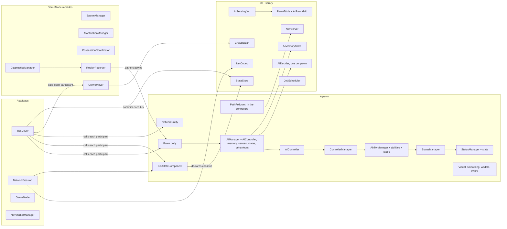
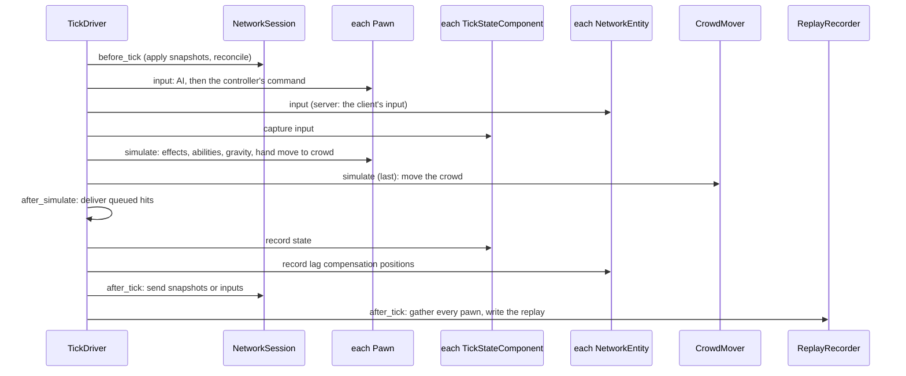
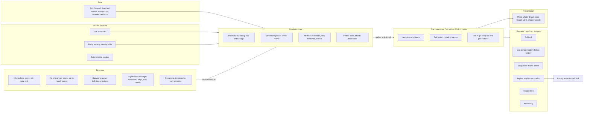
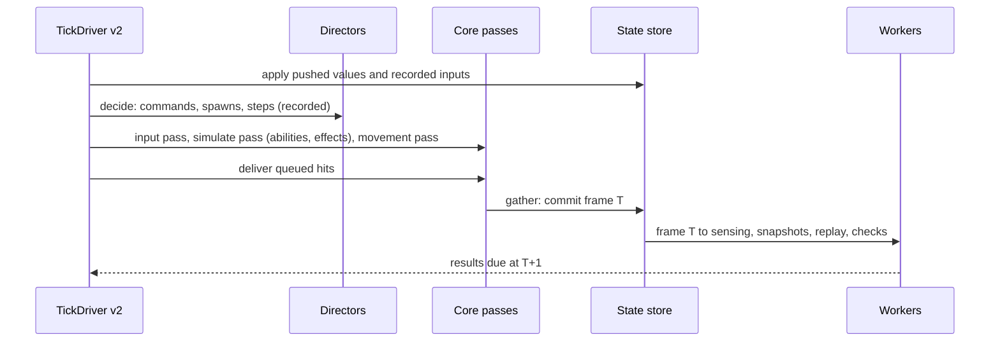
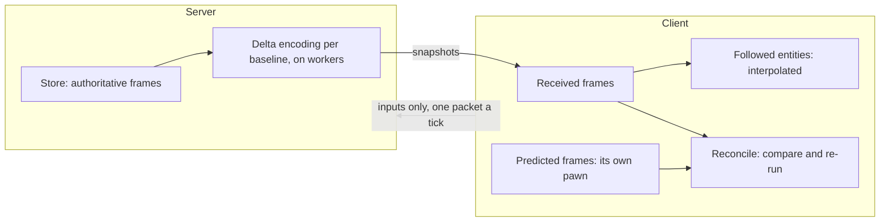
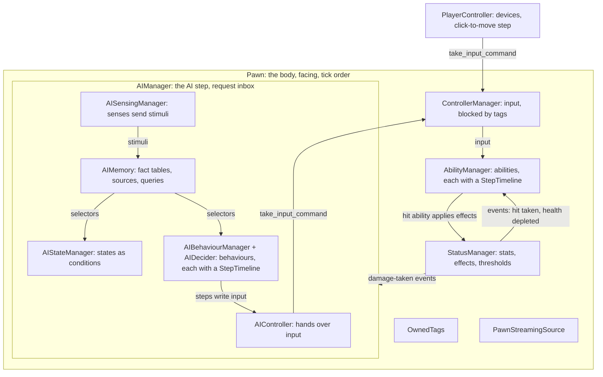

# Architecture Overview

*Written by Claude (claude-opus-5-5), 2026-11-19, at the end of the code audit, from the owner's request for one doc showing every module and how they connect.*

**What this is:** a map of the framework, today and after the coming refactor, with diagrams. Each system's README has the detail; the refactor's design is in [STATE_STORE_SPEC.md](state_store/STATE_STORE_SPEC.md), [ABILITY_SPEC.md](abilities/ABILITY_SPEC.md) and, for the pawn, its components, the AI, abilities and effects, [pawn spec 16](pawn/PAWN_SPEC.md) (the pawn redesign, agreed 2026-11-24). The plan is in [ROADMAP.md](ROADMAP.md).

**Status:** today's map is checked against the code (the audit, 2026-11-19); the problems it lists are as found then. The map after the refactor is the agreed direction, built in part on `refactor/tick-core` (the store and its commit, pushed columns, the landing schedule, the one pass that places what's drawn; state store spec 13.4-13.12): it changes as the specs do.

## 1. The big picture

A real-time 3D game runs in fixed-length **ticks** (60 a second by default). Everything that affects play happens inside a tick, in a fixed order, so the same inputs give the same results; everything else (drawing, menus, the camera) runs per rendered frame and only reads.

| Layer | What's in it | Runs |
|---|---|---|
| Time | `TickDriver`: the tick, its phases, rollback, the load ladder | every tick |
| The simulation core | The pawn, its abilities and steps, effects, stats, hits, movement (the crowd mover, physics) | inside ticks, deterministic |
| Directors | Players and the AI (commands), spawning, AI switch-off and tick steps, possession, streaming, terrain edits, nav commits | they decide; their outputs are inputs to the core |
| Records | Rollback history, snapshots, lag compensation, replay, diagnostics | after the tick |
| Presentation | Visuals, the camera, UI, debug views | every rendered frame, reading only |
| Workers | The job scheduler's threads (sensing, crowd moves), nav tile builds, the replay writer | beside the main thread |

## 2. Today

### 2.1 Modules

### 2.2 One tick today

### 2.3 What the audit found (state store spec 12)

- **The same data is kept many times.** Each entity's state is gathered or held by the rollback recorder, its input history, the network entity's lag compensation positions, the client's baselines, its follow buffer, its reconcile copy, the pawn table and the replay's channels.
- **Most per-tick work is per-pawn GDScript**: each pawn and each of its parts is called one by one, and gathers what it needs itself. Worker threads can't help until data is gathered once into plain buffers.
- **Some decisions depend on time:** the load ladder, spawns once a frame, AI switch-off per physics frame, chunk builds under a wall-clock budget, nav tiles committed under a time budget (since replaced by landing ticks, state store spec 13.12).
- **Each pawn carries its own node tree** of abilities, steps, behaviours, states, senses and stats (about 113 nodes a pawn in the 300-pawn battle).

## 3. After the refactor

### 3.1 Modules

### 3.2 One tick after the refactor

### 3.3 The rules it runs on

- **Commit at the end of the tick.** Nodes are the working copy during a tick; the store's frame is the truth after it. Anything that changes state from outside a tick writes the store, which writes the nodes.
- **Results land on a fixed tick.** A job that's late is finished by the main thread; nothing waits on a machine's speed.
- **Directors' outputs are recorded.** Replays play back frames; a branch re-runs from a keyframe with directors off until the branch point.
- **Gameplay drives presentation,** never the reverse. Visuals read frames.
- **Definitions are shared, state is per entity.** Abilities, behaviours and stats keep their settings in shared definitions and their state in columns.
- **Deadlines and version counters.** Every timer is the tick it ends; a reader copies again only when an owner's version counter has moved.

### 3.4 On the network

### 3.5 The pawn after the redesign (pawn spec 16)

- **Six components:** the controller manager, the ability manager, the status manager (stats and effects merged), owned tags, the AI tree, the streaming source. Gone: the navigation manager (paths are found by `NavServer` and followed inside movement steps), the target selector (a memory query), the decision module and `AIInputs`, the "hands" AI controller, hit interceptors and effect appliers (both gone since step 4).
- **One step system:** abilities and behaviours each own a `StepTimeline`; behaviour steps write input and run on every machine, so the order stream sends behaviour and step starts.
- **One modifier rule** for stats, abilities and behaviours, in an order designers choose (multiply, then add, by default).
- **Hits** are booked with the tick scheduler and resolved by a hit ability on the target; reactions are abilities started by events.
- **Memory** is a fact table that senses write stimuli into, read through selectors; awareness and certainty are separate.

## 4. Where things live

| Folder (`assets/scripts/`) | Today | After |
|---|---|---|
| `singletons/` | TickDriver, NetworkSession, GameMode, NavMarkerManager | TickDriver v2; NetworkSession split into connection, clock, snapshot sending and receiving |
| `netcode/` | TickStateComponent, NetworkEntity, lag compensation | The store's GDScript side and twin; lag compensation reading the history |
| `pawn/` | The pawn hub (about 630 lines) | The body, facing, tick order and general flags; one join point with the entity registry |
| `abilities/` | Abilities and steps as nodes with their own settings and state | Thin nodes, definitions, step timelines (the shared step core), deadlines, the hit ability, abilities started by events |
| `ai/` | Managers, senses, states, behaviours; C++ decides per pawn | One AI tree per pawn (`AIManager`), fact-table memory fed by stimuli, behaviours built from steps, an `AIDecider` per pawn; an opt-in batch runner |
| `movement/` | The crowd mover | The movement pass; the path follower in movement steps |
| `effects/`, `stats/` | The effect manager, the stat manager | One status manager: stats, effects (modifiers and effectors), thresholds |
| `replay/` | Channels gathering per pawn | Keyframes and deltas of frames |
| `diagnostics/` | Frame timing, session log, panels | Plus the store inspector, game speed, worker time |
| `visuals/` | Per-pawn scripts | One batched pass, LOD, shader waddle |
| `native/src/` | The C++ library | The store (built) |

## 5. Order of work

1. The measurements (state store spec 13) and these docs, on master.
2. Branch from master. Rewrite in place (the owner's call, 2026-11-19): the tick driver and the store, the pawn and the movement pass, abilities v2, the AI on the store, netcode on the store, replay and diagnostics, the directors onto ticks.
3. The pawn redesign, in the build order of pawn spec 16.10: foundations, the step core, the status manager, hits, input and controllers, AI decisions, behaviour steps, memory and senses, entities, units, content.
4. The shader waddle A/B (state store spec 12.5) is independent of the core.
